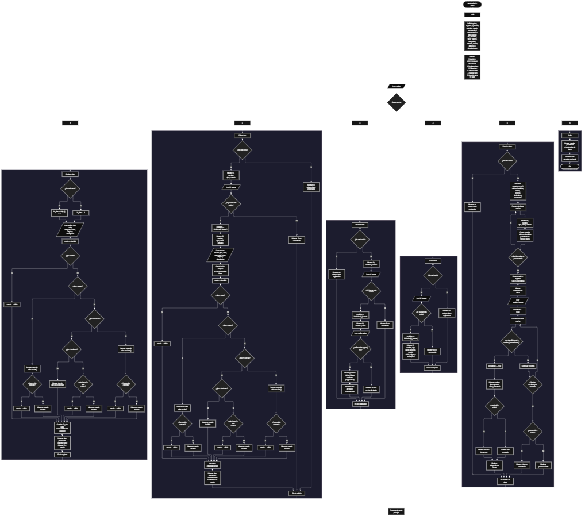

<escape></escape>

Este proyecto, llamado <b>aterrizador de datos</b>, fue desarrollado en <b>python</b> como un ejercicio práctico para fortalecer la lógica de programación mediante la creación de un sistema de gestión, validación y procesamiento de datos desde la consola. El programa cuenta con un menú principal de seis opciones que permite <b>registrar, editar, eliminar, buscar, listar y procesar información</b> almacenada. Cada registro contiene datos como el nombre, tipo, valor, categoría, estado, fecha de recepción, origen y descripción, utilizando nueve listas paralelas para organizar la información durante la ejecución. Además, incorpora un mecanismo de validación que permite identificar si los valores corresponden al tipo de dato indicado, incluyendo <b>texto, entero, decimal y booleano</b>. Durante su desarrollo se aplicaron conceptos fundamentales de programación, como variables, listas, estructuras condicionales, ciclos repetitivos, estructuras de selección, manejo de excepciones y operaciones para administrar registros. Este proyecto permite poner en práctica los conocimientos adquiridos en Python y sirve como base para desarrollar sistemas de procesamiento y validación de información más avanzados.

<h2 align="center">⚙️ Funcionamiento del menú principal</h2>

### ➕ Registrar dato

La opción <b>1) registrar dato</b> permite incorporar un nuevo registro al sistema. Antes de almacenar la información, el programa comprueba si la lista <b>ids</b> está vacía mediante la condición <b>len(ids) == 0</b>. Si no existen registros, asigna el identificador <b>1</b> a la variable <b>id_dato</b>; en caso contrario, genera el siguiente identificador sumando uno al último ID almacenado mediante <b>ids[-1] + 1</b>. Después, solicita el <b>nombre, tipo de dato, valor, categoría, fecha de recepción, origen y descripción</b>. Una vez recopilada la información, inicializa la variable <b>estado</b> con el valor <b>"inválido"</b> y realiza la validación según el tipo indicado. Si el tipo es <b>texto</b>, acepta directamente el contenido. Si es <b>entero</b>, utiliza <b>int(valor)</b> dentro de una estructura <b>try/except</b> para comprobar que el valor pueda convertirse a un número entero. Para el tipo <b>decimal</b>, utiliza <b>float(valor)</b> con el mismo mecanismo de manejo de excepciones. En el caso del tipo <b>booleano</b>, comprueba que el valor introducido sea <b>"true"</b> o <b>"false"</b>, sin distinguir entre mayúsculas y minúsculas mediante <b>lower()</b>. Si el tipo no coincide con ninguno de los permitidos, muestra el mensaje <b>"tipo de dato no reconocido."</b> y conserva el estado como inválido. Finalmente, almacena el identificador y los ocho campos en sus respectivas listas mediante <b>append()</b>, mostrando el mensaje <b>"dato procesado correctamente."</b>, el ID asignado y el estado obtenido.

### ✏️ Editar dato

La opción <b>2) editar dato</b> permite modificar la información de un registro existente. Primero, el programa comprueba si la lista <b>ids</b> está vacía. Si no existen registros, muestra el mensaje <b>"no existen datos registrados."</b>. En caso contrario, presenta una lista con el ID, nombre, tipo y estado de cada dato utilizando un ciclo <b>for</b>. Después, solicita el identificador del registro que se desea modificar y comprueba si está almacenado mediante la condición <b>id_buscar in ids</b>. Si existe, obtiene su posición con <b>ids.index(id_buscar)</b> y muestra algunos de sus datos actuales: ID, nombre, tipo y valor. A continuación, solicita el nuevo nombre, tipo, valor, categoría, fecha, origen y descripción, actualizando directamente los elementos correspondientes de las listas. Una vez modificada la información, inicializa nuevamente el estado como <b>"inválido"</b> y ejecuta las validaciones según el tipo seleccionado: texto, entero, decimal o booleano. Para comprobar los valores enteros y decimales utiliza <b>try/except</b>, mientras que para los booleanos verifica los valores <b>"true"</b> y <b>"false"</b>. Finalmente, muestra el mensaje <b>"dato actualizado correctamente."</b> y el nuevo estado del registro. Si el ID introducido no se encuentra en la lista, presenta el mensaje <b>"id no encontrada."</b>. El identificador original se conserva durante la edición.

### 🗑️ Eliminar dato

La opción <b>3) eliminar dato</b> permite eliminar un registro almacenado mediante su identificador. Antes de comenzar, el programa comprueba si existen datos registrados. Si la lista <b>ids</b> está vacía, muestra el mensaje <b>"no existen datos registrados."</b>. Si hay información disponible, presenta una lista con el ID, nombre y estado de cada registro mediante un ciclo <b>for</b>. Después, solicita el ID del dato que se desea eliminar y comprueba si existe utilizando <b>id_buscar in ids</b>. Cuando encuentra una coincidencia, obtiene su posición mediante <b>ids.index(id_buscar)</b> y muestra el identificador, nombre y valor del registro seleccionado. Posteriormente, solicita una confirmación mediante la variable <b>confirmacion</b>. Si el usuario introduce la letra <b>"s"</b>, comprobada con <b>confirmacion.upper() == "S"</b>, el programa elimina la información correspondiente utilizando <b>pop(posicion)</b> en las nueve listas: <b>ids, nombres, tipos, valores, categorias, estados, fechas, origenes y descripciones</b>. Finalmente, muestra el mensaje <b>"dato eliminado correctamente."</b>. Si el usuario no confirma la operación, presenta el mensaje <b>"el dato no fue eliminado."</b>. Si el ID introducido no corresponde a ningún registro, muestra <b>"id no encontrada."</b>. Esta operación elimina directamente la posición correspondiente en todas las listas, manteniendo la relación entre los datos almacenados.

### 🔎 Buscar dato

La opción <b>4) buscar dato</b> permite localizar un registro mediante su identificador. Primero, el programa comprueba si existen datos almacenados en la lista <b>ids</b>. Si no hay registros, muestra el mensaje <b>"no existen datos registrados."</b>. En caso contrario, solicita el ID que se desea consultar y verifica su existencia mediante la condición <b>id_buscar in ids</b>. Cuando encuentra el identificador, utiliza <b>ids.index(id_buscar)</b> para obtener la posición correspondiente en las listas. Después, muestra la información completa del registro: <b>ID, nombre, tipo, valor, categoría, estado, fecha, origen y descripción</b>. Si el identificador introducido no se encuentra entre los registros almacenados, presenta el mensaje <b>"id no encontrada."</b>. Esta función facilita consultar individualmente la información de cualquier dato registrado sin necesidad de recorrer manualmente todas las listas.

### 📋 Lista de datos

La opción <b>5) lista de datos</b> permite visualizar los registros almacenados y consultar estadísticas sobre la información procesada. Primero, el programa comprueba si existen datos registrados. Si la lista <b>ids</b> está vacía, muestra el mensaje <b>"no existen datos registrados."</b>. Si hay registros disponibles, inicializa seis contadores: <b>validos, invalidos, textos, enteros, decimales y booleanos</b>, todos con el valor cero. Después, utiliza un ciclo <b>for</b> para recorrer las listas y mostrar el ID, nombre, tipo, valor y estado de cada registro. Durante el recorrido, comprueba el estado mediante <b>estados[i].lower()</b>, incrementando los contadores de datos válidos e inválidos según corresponda. También clasifica los registros de acuerdo con su tipo, utilizando <b>tipos[i].lower()</b> para contar los datos de texto, entero, decimal y booleano. Al finalizar el recorrido, muestra las estadísticas del sistema, incluyendo la cantidad total de registros mediante <b>len(ids)</b>, los datos válidos, inválidos y la distribución por tipo. Esta funcionalidad permite conocer la cantidad y clasificación de los datos almacenados durante la ejecución del programa.

### 📄 Procesar dato

Dentro de la opción <b>5) lista de datos</b>, el programa incorpora una funcionalidad adicional denominada <b>aterrizador de datos</b>, que permite procesar un registro mediante su nombre. Después de mostrar las estadísticas, solicita al usuario el nombre del dato que desea procesar mediante la variable <b>nombre_buscar</b>. A continuación, inicializa la variable lógica <b>encontrado</b> con el valor <b>False</b> y utiliza un ciclo <b>for</b> para recorrer la lista <b>nombres</b>. Durante el recorrido, compara el nombre introducido con los nombres almacenados mediante la condición <b>nombres[i].lower() == nombre_buscar.lower()</b>, permitiendo realizar la comparación sin distinguir entre mayúsculas y minúsculas. Cuando encuentra una coincidencia, cambia <b>encontrado</b> a <b>True</b> y muestra los datos del registro: nombre, tipo esperado, valor y resultado de la validación. Posteriormente, comprueba si el estado es <b>"válido"</b>. Si lo es, muestra el mensaje <b>"el dato fue aceptado correctamente."</b>; de lo contrario, informa que el dato presenta un formato incorrecto. Después utiliza <b>break</b> para finalizar la búsqueda al encontrar la primera coincidencia. Si termina el recorrido y la variable <b>encontrado</b> continúa siendo <b>False</b>, muestra el mensaje <b>"dato no encontrado."</b>. Esta funcionalidad permite consultar el resultado de la validación de un registro específico utilizando su nombre.

### 🚪 Salir del menú principal

La opción <b>6) salir</b> está destinada a finalizar la ejecución del programa. Cuando el usuario selecciona esta opción, el sistema muestra el mensaje <b>"gracias por utilizar el aterrizador de datos."</b> y ejecuta la instrucción <b>break</b>, que interrumpe el ciclo principal <b>while True</b>. De esta manera, el programa termina su ejecución y deja de mostrar el menú principal.

<h2 align="center">🧠 Temas aplicados en el proyecto</h2>

### 📦 Variables

En este proyecto se utilizan variables para controlar las opciones seleccionadas en el menú, generar identificadores, almacenar temporalmente la información introducida, localizar registros, determinar sus estados y calcular las estadísticas del sistema. Cada variable cumple una función específica dentro de las operaciones de administración, validación y procesamiento de datos.

🔢 **Opcion:** Almacena la opción seleccionada por el usuario en el menú principal.

🆔 **Id_dato:** Almacena el identificador generado para cada nuevo registro.

🔎 **Id_buscar:** Almacena el ID introducido por el usuario para localizar un registro.

📍 **Posicion:** Guarda el índice correspondiente al registro encontrado en las listas.

📝 **Nombre:** Almacena temporalmente el nombre del dato durante su registro.

🔠 **Tipo:** Almacena el tipo de dato seleccionado durante el registro.

📊 **Valor:** Almacena el contenido que será evaluado según el tipo indicado.

📁 **Categoria:** Almacena la categoría asignada al registro.

📅 **Fecha:** Almacena la fecha de recepción del dato.

🌐 **Origen:** Almacena el origen de la información registrada.

📄 **Descripcion:** Almacena una descripción del dato.

✅ **Estado:** Determina si el valor registrado cumple con el formato correspondiente al tipo indicado.

🔄 **Confirmacion:** Almacena la respuesta del usuario antes de eliminar un registro.

🔢 **Validos:** Cuenta los registros cuyo estado es válido.

⚠️ **Invalidos:** Cuenta los registros cuyo estado es inválido.

📝 **Textos:** Cuenta los registros clasificados como texto.

🔢 **Enteros:** Cuenta los registros clasificados como entero.

🔣 **Decimales:** Cuenta los registros clasificados como decimal.

🔘 **Booleanos:** Cuenta los registros clasificados como booleano.

🔎 **Nombre_buscar:** Almacena el nombre introducido para localizar un dato durante el procesamiento.

✅ **Encontrado:** Variable lógica que indica si se encontró un registro con el nombre solicitado.

🔄 **I:** Funciona como índice para recorrer las listas y acceder a los registros almacenados.

### 🗃️ Listas

En este proyecto se utilizan nueve listas paralelas para almacenar y organizar la información de cada registro. Todas comienzan vacías y se relacionan mediante sus posiciones, de manera que cada índice representa un mismo dato dentro de las nueve listas. Por ejemplo, la información del primer registro se encuentra distribuida entre <b>ids[0], nombres[0], tipos[0], valores[0], categorias[0], estados[0], fechas[0], origenes[0] y descripciones[0]</b>. Esta organización permite registrar, consultar, modificar, eliminar y procesar la información manteniendo la correspondencia entre sus diferentes campos.

🆔 **Ids:** Almacena los identificadores únicos asignados a los registros durante su creación.

📝 **Nombres:** Almacena los nombres de los datos registrados.

🔠 **Tipos:** Almacena el tipo de dato indicado: texto, entero, decimal o booleano.

📊 **Valores:** Almacena los valores introducidos por el usuario para cada registro.

📁 **Categorias:** Almacena las categorías asignadas a los datos.

✅ **Estados:** Almacena el resultado de la validación de cada registro, utilizando los valores válido o inválido.

📅 **Fechas:** Almacena las fechas de recepción de los datos.

🌐 **Origenes:** Almacena el origen de la información registrada.

📄 **Descripciones:** Almacena las descripciones correspondientes a cada dato.

### 🔀 Estructuras condicionales

En este proyecto se utilizan las estructuras <b>if, elif y else</b> para controlar las operaciones del menú, determinar si existen registros almacenados, comprobar si un identificador se encuentra en las listas y seleccionar el procedimiento de validación correspondiente al tipo de dato. También permiten comprobar si un registro es válido o inválido, clasificar los datos para las estadísticas, verificar las coincidencias durante las búsquedas y determinar si el usuario confirma o cancela una eliminación. Estas condiciones permiten que el programa ejecute diferentes instrucciones según los resultados obtenidos durante cada operación.

### 🔄 Estructuras repetitivas

En este proyecto se utilizan los ciclos <b>while</b> y <b>for</b> para controlar la ejecución del programa y recorrer los registros almacenados. El ciclo <b>while True</b> mantiene activo el menú principal hasta que el usuario selecciona la opción de salida, momento en el que se ejecuta <b>break</b>. Por otro lado, los ciclos <b>for</b> permiten recorrer las listas para mostrar los registros, localizar información, calcular estadísticas y procesar datos mediante su nombre. Estas estructuras facilitan la ejecución repetida de operaciones sin necesidad de escribir instrucciones individuales para cada registro.

### 🎯 Estructura de selección

El programa utiliza una estructura de selección basada en <b>if, elif y else</b> para determinar qué operación debe ejecutarse según la opción introducida por el usuario. Cada condición representa una funcionalidad del sistema: <b>registrar, editar, eliminar, buscar, listar datos o salir</b>. También se utiliza <b>else</b> para mostrar el mensaje <b>"opción no válida."</b> cuando el usuario introduce una opción que no corresponde a ninguna de las alternativas disponibles.

### 🔢 Generación de identificadores

El programa utiliza la lista <b>ids</b> para controlar los identificadores de los registros. Cuando se registra el primer dato, asigna el valor <b>1</b> mediante la condición <b>len(ids) == 0</b>. Para los siguientes registros, obtiene el último identificador almacenado con <b>ids[-1]</b> y le suma uno. De esta manera, cada nuevo registro recibe un identificador calculado a partir del último elemento de la lista. Sin embargo, si se elimina el último registro, el siguiente identificador puede reutilizarse porque el programa no mantiene un contador independiente.

### 🛡️ Validación de tipos de datos

Una de las funcionalidades principales del proyecto consiste en comprobar si los valores introducidos corresponden al tipo de dato seleccionado. Para ello, el programa utiliza las condiciones <b>if, elif y else</b>, junto con conversiones de tipos y comparaciones de cadenas. Los valores enteros se comprueban mediante <b>int()</b>, los decimales mediante <b>float()</b>, los booleanos mediante la comparación con <b>"true"</b> y <b>"false"</b>, y los textos se aceptan directamente. El resultado de estas comprobaciones se almacena en la lista <b>estados</b>, utilizando los valores <b>"válido"</b> e <b>"inválido"</b>.

### ⚠️ Manejo de excepciones

El programa utiliza las estructuras <b>try y except</b> para controlar los errores que pueden producirse al convertir un valor a entero o decimal. En el caso de los números enteros, intenta ejecutar <b>int(valor)</b>; si se produce una excepción <b>ValueError</b>, asigna el estado inválido al registro. Para los números decimales, realiza el mismo procedimiento utilizando <b>float(valor)</b>. Este mecanismo permite comprobar los valores introducidos sin interrumpir la ejecución del programa cuando el contenido no puede convertirse al tipo solicitado.

### 🔍 Búsqueda de registros

El proyecto incorpora mecanismos de búsqueda para localizar registros mediante su identificador o nombre. En las operaciones de edición, eliminación y consulta, utiliza el operador <b>in</b> para comprobar si un ID existe en la lista <b>ids</b> y el método <b>index()</b> para obtener su posición. En el procesamiento de datos, utiliza un ciclo <b>for</b> para recorrer la lista <b>nombres</b> y comparar los valores mediante <b>lower()</b>. Además, utiliza la variable lógica <b>encontrado</b> para determinar si se localizó una coincidencia.

### 📊 Contadores y estadísticas

El programa utiliza seis contadores para obtener información sobre los registros almacenados. Las variables <b>validos</b> e <b>invalidos</b> permiten conocer cuántos datos superaron o no la validación. Por otra parte, <b>textos, enteros, decimales y booleanos</b> permiten clasificar los registros según el tipo indicado. Estos contadores se inicializan en cero y aumentan durante el recorrido de las listas cuando se cumple la condición correspondiente. Al finalizar, el programa muestra la cantidad total de datos mediante <b>len(ids)</b> y presenta las estadísticas calculadas.

### 🔄 Manipulación de listas

Para administrar los registros, el programa utiliza los métodos <b>append()</b> y <b>pop()</b>, además del método <b>index()</b>. El método <b>append()</b> permite agregar nuevos elementos al final de las nueve listas durante el registro. El método <b>index()</b> permite localizar la posición de un identificador existente para consultar o modificar su información. Finalmente, <b>pop(posicion)</b> elimina el elemento correspondiente en cada lista cuando el usuario confirma la eliminación de un registro. Estas operaciones mantienen organizados los datos y permiten administrar los registros mediante sus posiciones.

<h2 align="center">¿Cómo se implementaron las operaciones crud en el proyecto?</h2>

Las operaciones <b>crud</b> se implementaron mediante las opciones del menú principal, permitiendo administrar los registros almacenados en el sistema. La operación <b>crear</b> corresponde a <b>registrar dato</b>, donde se genera un identificador, se solicitan los campos y se almacena la información mediante <b>append()</b>. La operación <b>leer</b> se realiza mediante <b>buscar dato</b> y <b>lista de datos</b>, que permiten consultar los registros individualmente o visualizar la información almacenada. La operación <b>actualizar</b> corresponde a <b>editar dato</b>, donde se localiza un registro mediante su ID y se modifican sus campos, recalculando su estado. Finalmente, la operación <b>eliminar</b> se realiza mediante <b>eliminar dato</b>, que permite borrar un registro confirmado utilizando <b>pop(posicion)</b> en las nueve listas. Estas operaciones utilizan variables, listas, condicionales, ciclos y métodos de manipulación para administrar la información temporalmente durante la ejecución del programa.

<h2 align="center">Diagrama de flujo del proyecto</h2>

<escape></escape>

<h2 align="center">🛡️ Validaciones del programa</h2>

### 📭 No existen datos registrados

Esta validación se utiliza en las opciones de <b>editar, eliminar, buscar y lista de datos</b>. El programa comprueba si la lista <b>ids</b> está vacía mediante la condición <b>len(ids) == 0</b>. Si no existen registros almacenados, muestra el mensaje <b>"no existen datos registrados."</b>. Esta comprobación evita continuar con operaciones que necesitan información registrada cuando las listas se encuentran vacías.

### 🔠 Validación de texto

Cuando el usuario selecciona el tipo <b>texto</b>, el programa asigna directamente el estado <b>"válido"</b> al registro, sin realizar conversiones adicionales sobre el contenido introducido. Esta validación se utiliza tanto durante el registro como durante la edición de un dato.

### 🔢 Validación de números enteros

Cuando se selecciona el tipo <b>entero</b>, el programa utiliza la función <b>int()</b> dentro de una estructura <b>try/except</b> para comprobar si el valor introducido puede convertirse a un número entero. Si la conversión se realiza correctamente, asigna el estado <b>"válido"</b>. Si se produce una excepción <b>ValueError</b>, establece el estado <b>"inválido"</b>. Este procedimiento permite identificar valores que no cumplen con el formato de un número entero.

### 🔣 Validación de números decimales

Cuando se selecciona el tipo <b>decimal</b>, el programa utiliza la función <b>float()</b> dentro de una estructura <b>try/except</b>. Si el valor puede convertirse correctamente a un número decimal, asigna el estado <b>"válido"</b>. En caso de producirse una excepción <b>ValueError</b>, establece el estado <b>"inválido"</b>. Esta comprobación permite reconocer valores numéricos que pueden representarse mediante el tipo decimal de Python.

### 🔘 Validación de valores booleanos

Cuando el usuario selecciona el tipo <b>booleano</b>, el programa comprueba si el valor introducido corresponde a <b>"true"</b> o <b>"false"</b>, utilizando el método <b>lower()</b> para evitar diferencias entre mayúsculas y minúsculas. Si coincide con alguno de estos valores, asigna el estado <b>"válido"</b>. Si no corresponde a ninguna de las dos alternativas, conserva el estado <b>"inválido"</b>.

### ⚠️ Tipo de dato no reconocido

Esta validación se utiliza cuando el usuario introduce un tipo diferente de <b>texto, entero, decimal o booleano</b>. El programa muestra el mensaje <b>"tipo de dato no reconocido."</b> y conserva el estado <b>"inválido"</b>. Aunque el tipo no sea reconocido, el registro continúa almacenándose en las listas, por lo que queda disponible para las operaciones de consulta, edición y eliminación.

### 🆔 Identificador no encontrado

Esta validación se utiliza durante las operaciones de <b>editar, eliminar y buscar dato</b>. El programa comprueba si el identificador introducido se encuentra en la lista <b>ids</b> mediante la condición <b>id_buscar in ids</b>. Si existe, obtiene su posición utilizando <b>index()</b> y ejecuta la operación correspondiente. Si no encuentra el identificador, muestra el mensaje <b>"id no encontrada."</b>, evitando realizar modificaciones o eliminaciones sobre un registro inexistente.

### 🔎 Dato no encontrado

Esta validación se utiliza durante el procesamiento de datos mediante su nombre. El programa inicializa la variable <b>encontrado</b> con el valor <b>False</b> y recorre la lista <b>nombres</b> para comparar los registros con el nombre introducido. Cuando encuentra una coincidencia, cambia la variable a <b>True</b> y muestra la información del dato. Si termina el recorrido sin encontrar coincidencias, muestra el mensaje <b>"dato no encontrado."</b>. La comparación utiliza <b>lower()</b> para ignorar las diferencias entre mayúsculas y minúsculas, y la búsqueda se detiene después de la primera coincidencia mediante <b>break</b>.

### ❌ Estado del dato

El programa utiliza la lista <b>estados</b> para almacenar el resultado de la validación de cada registro. Los valores posibles son <b>"válido"</b> e <b>"inválido"</b>. Durante el registro y la edición, el estado se determina según el tipo y el valor introducidos. Posteriormente, durante el procesamiento, el programa comprueba si el estado es <b>"válido"</b>. Si lo es, informa que el dato fue aceptado correctamente; de lo contrario, indica que presenta un formato incorrecto.

### ⚠️ Confirmación de eliminación

Antes de eliminar un registro, el programa solicita una confirmación mediante la variable <b>confirmacion</b>. La condición <b>confirmacion.upper() == "S"</b> permite aceptar la eliminación cuando el usuario introduce la letra <b>"s"</b>, independientemente de si está escrita en mayúscula o minúscula. Si se cumple la condición, elimina los elementos correspondientes de las nueve listas. Si no se cumple, muestra el mensaje <b>"el dato no fue eliminado."</b> y conserva el registro almacenado.

### ⚠️ Limitaciones de validación

El programa no incorpora comprobaciones para impedir el registro de campos vacíos, validar el formato de las fechas, restringir las categorías a valores específicos o limitar la cantidad de registros. Tampoco controla las entradas no numéricas al solicitar un identificador, por lo que la conversión mediante <b>int()</b> puede producir una excepción. Además, la generación de identificadores utiliza el último elemento de la lista <b>ids</b>, por lo que un identificador eliminado puede volver a utilizarse si correspondía al último registro. Estas características representan las limitaciones actuales de la implementación.

<h2 align="center">🎯 Objetivo del proyecto</h2>

El objetivo principal de este proyecto es fortalecer la <b>lógica de programación</b> mediante el desarrollo de un sistema de gestión y procesamiento de datos en <b>python</b>. A través de su construcción se busca aplicar los conocimientos adquiridos sobre variables, listas, estructuras condicionales, ciclos repetitivos, estructuras de selección y manejo de excepciones, integrándolos para resolver problemas relacionados con el almacenamiento y la validación de información. Además, el proyecto permite comprender cómo registrar, consultar, modificar y eliminar datos, así como verificar su formato según diferentes tipos y obtener estadísticas sobre los registros almacenados. De esta manera, se establece una base para desarrollar sistemas de procesamiento de información más completos utilizando otros lenguajes y tecnologías.

<escape></escape>